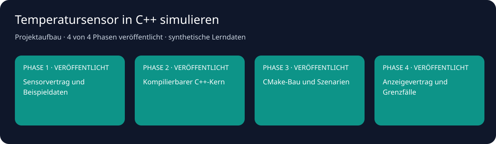

# Temperatursensor in C++ simulieren

Ein Prototyp soll Temperaturverläufe überwachen und Schwellenüberschreitungen reproduzierbar melden, bevor echte Sensorhardware verfügbar ist.



**Veröffentlichungsstand: Phase 4/4.** Dieses eigenständige Repository übernimmt zunächst den bereits lokal committeten Stand. Weitere fachliche Phasen werden im Abstand von mindestens vier Stunden veröffentlicht. Die technische Entwicklung und die öffentliche Veröffentlichung haben unterschiedliche echte Zeitpunkte.

## Was hier zu sehen ist

| Schritt | Inhalt | Hier veröffentlicht |
|---|---|---|
| 1 | Sensorvertrag und Beispieldaten | Ja |
| 2 | Kompilierbarer C++-Kern | Ja |
| 3 | CMake-Bau und Szenarien | Ja |
| 4 | Anzeigevertrag und Grenzfälle | Ja |

## Fachlicher Nutzen

C++-Fachlogik, reproduzierbarer Build, Zustandsübergänge und technische Grenzwertprüfung.

## Lokal starten

Im geklonten Repository ausführen; die benötigte Laufzeit muss installiert sein. Python-Beispiele verwenden 3.12, Node-Beispiele 24 und C# die im Projekt angegebene .NET-Version. Befehle mit uv laden die dort genau bezeichneten Pakete bei Bedarf.

```powershell
cmake -S . -B build
cmake --build build
```

Ausführliche technische Befehle: [START.md](START.md). [Öffentlicher Prüfstand](ABNAHME.json) und [Quellphasen](VERLAUF.json) dokumentieren Herkunft und echte Ausführungsdaten. Eine neue Repositorykopie ist kein neuer nativer Desktoplauf.

## Ergebnis des lokal geprüften Schlussstands

Tatsächlich kompilierte C++-Ausführung und reproduzierbare Temperatur-/Fehlerszenarien.

## Grenzen

Simulation ohne Hardware. Qt und MQTT sind nicht implementiert.

Eigenes kleines Lernprojekt mit synthetischen Daten, mit KI-Unterstützung entwickelt und geprüft. Keine Aussage über Berufserfahrung, menschliche Arbeitsstunden oder praktische Verwendung weiterer nur geplanter Produkte.

## Entwicklungshistorie

[Entwicklungshistorie](HISTORIE.md): die vorhandenen lokalen Änderungen, ihre ursprünglichen Daten und die spätere GitHub-Übernahme.
